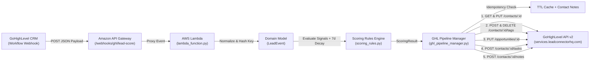

# GoHighLevel Automated Lead Scoring Engine (`ghl-lead-scoring-service`)

A production-ready, event-driven serverless Python microservice built for **AWS Lambda** and **GoHighLevel (GHL API v2)**. It ingests real-time GHL workflow/contact webhooks via Amazon API Gateway, deduplicates webhook retries, evaluates engagement signals and inactivity time-decay through a configurable rules engine, atomically updates contact lead scores, promotes or downgrades opportunities, creates urgent **Speed-to-Lead** sales tasks, and appends timestamped audit notes.

---

## Enterprise Capabilities

1. **Inactivity Time-Decay Engine & Hot Lead Downgrade**
   - Inspects `lastActivityDate` (ISO-8601 timestamp) on incoming contact payloads.
   - Applies a configurable penalty for every full 7-day period of inactivity (default: `-5` pts per 7 days inactive, capped at `-30` pts maximum decay) and records an explicit breakdown line item (`Inactivity Time-Decay`).
   - If a previously qualified Hot Lead (`previous_score >= 50`) drops below `50` after decay, the service automatically removes the `"Hot Lead"` tag (`DELETE /contacts/{contactId}/tags`) and adds `"Re-Engagement Needed"` (`POST /contacts/{contactId}/tags`).

2. **Two-Layer Webhook Event Deduplication / Idempotency**
   - Extracts an idempotency key from `eventId` / `webhookId` or computes a deterministic SHA-256 digest of `contactId + activityType + timestamp`.
   - Checks both a warm-container **in-memory TTL cache** (`IdempotencyCache`) and **contact notes/metadata** (`GET /contacts/{contactId}`) so duplicate GHL webhook deliveries return `HTTP 200` with `"status": "duplicate_ignored"` without double-counting points.

3. **Speed-to-Lead Automated Sales Task Creation**
   - When a lead newly crosses `new_score >= 50`, automatically creates an urgent follow-up task via `POST /contacts/{contactId}/tasks`:
     - **`title`**: `"URGENT: Call Hot Lead (Score: <new_score>)"`
     - **`body`**: Summary of matched high-intent behaviors
     - **`dueDate`**: 15 minutes from the event timestamp (ISO-8601 UTC)
     - **`assignedTo`**: Contact's `assignedTo` sales rep user ID if present in payload.

---

## Architecture Overview



```text
+-----------------------+      HTTPS POST       +------------------------+
|   GoHighLevel (GHL)   | --------------------> |   Amazon API Gateway   |
|  Workflow / Webhooks  |                       | /webhooks/ghl/lead-... |
+-----------------------+                       +-----------+------------+
                                                            |
                                                            v
+-----------------------+   GHL API v2 (REST)   +------------------------+
| GoHighLevel CRM v2    | <==================== |   AWS Lambda Handler   |
| - PUT /contacts/{id}  |   - Idempotency TTL   |  - LeadScoringEngine   |
| - POST/DELETE ../tags |   - 7d Decay Engine   |  - InactivityDecay     |
| - PUT /opportunities  |   - Retry + Backoff   |  - GHLPipelineManager  |
| - POST .../tasks      |   - Dry-Run Mode      +------------------------+
| - POST .../notes      |
+-----------------------+
```

---

## Scoring Matrix & Threshold Actions

### Default Scoring Rules & Time-Decay

| Signal / Activity / Custom Field | Category | Points Delta | Rule ID |
| :--- | :---: | :---: | :--- |
| **Booked Appointment** | Positive | `+20` | `booked_appointment` |
| **Form Submitted** | Positive | `+15` | `form_submitted` |
| **Clicked SMS Link** | Positive | `+10` | `clicked_sms_link` |
| **Budget > \$5k** *(Custom Field)* | Positive | `+5` | `budget_over_5k` |
| **No Show** | Negative | `-10` | `no_show` |
| **Unsubscribed** | Negative | `-15` | `unsubscribed` |
| **Inactivity Time-Decay** *(per 7 days inactive, max `-30`)* | Negative | `-5 / 7d` | `inactivity_time_decay` |

### Automated Pipeline Thresholds

| Score Transition | Status | Automated CRM Actions |
| :--- | :--- | :--- |
| **`new_score >= 50`** | `HOT_LEAD` | 1. Updates `lead_score` custom field (`PUT /contacts/{contactId}`)<br>2. Adds `"Hot Lead"` tag (`POST /contacts/{contactId}/tags`)<br>3. Moves active opportunity to stage `"Priority Outreach"` (`PUT /opportunities/{opportunityId}`)<br>4. Creates urgent **Speed-to-Lead** task due in 15 mins (`POST /contacts/{contactId}/tasks`)<br>5. Appends timestamped breakdown note (`POST /contacts/{contactId}/notes`) |
| **`previous >= 50` $\rightarrow$ `0 <= new < 50`** | `RE_ENGAGEMENT_NEEDED` | 1. Updates `lead_score` custom field (`PUT /contacts/{contactId}`)<br>2. Removes `"Hot Lead"` tag (`DELETE /contacts/{contactId}/tags`)<br>3. Adds `"Re-Engagement Needed"` tag (`POST /contacts/{contactId}/tags`)<br>4. Appends timestamped breakdown note (`POST /contacts/{contactId}/notes`) |
| **`0 <= new_score < 50`** | `STANDARD` | 1. Updates `lead_score` custom field (`PUT /contacts/{contactId}`)<br>2. Appends timestamped breakdown note (`POST /contacts/{contactId}/notes`) |
| **`new_score < 0`** | `DISQUALIFIED` | 1. Updates `lead_score` custom field (`PUT /contacts/{contactId}`)<br>2. Adds `"Disqualified"` tag (`POST /contacts/{contactId}/tags`)<br>3. Appends timestamped breakdown note (`POST /contacts/{contactId}/notes`) |
| **Duplicate `eventId` / Hash** | `DUPLICATE_IGNORED` | Returns `HTTP 200` (`"status": "duplicate_ignored"`) with `pointsDelta: 0` and zero upstream write mutations. |

---

## Repository Structure

```text
ghl-lead-scoring-service/
├── src/
│   ├── __init__.py
│   ├── handlers/
│   │   ├── __init__.py
│   │   └── lambda_function.py       # AWS Lambda entry point, idempotency & 3-scenario CLI demo
│   ├── rules/
│   │   ├── __init__.py
│   │   └── scoring_rules.py         # Configurable rules engine + 7-day Inactivity Time-Decay
│   ├── services/
│   │   ├── __init__.py
│   │   └── ghl_pipeline_manager.py  # GHL API v2 client (tags, stages, tasks, notes, TTL cache)
│   └── models/
│       ├── __init__.py
│       └── lead_event.py            # Webhook normalization, SHA-256 idempotency & result models
├── tests/
│   ├── __init__.py
│   └── test_lead_scoring.py         # 25 unit & integration tests (pytest / unittest)
├── serverless.yml                   # Serverless Framework v3 AWS deployment config
├── requirements.txt                 # Python dependencies
├── .env.example                     # Environment variable template
├── .gitignore                       # Git exclusions (.venv/, .env, __pycache__/)
└── README.md                        # Architecture & operational documentation
```

---

## Getting Started & Local Setup

### 1. Create a Virtual Environment & Install Dependencies

```bash
python -m venv .venv

# Windows (PowerShell)
.\.venv\Scripts\Activate.ps1

# macOS / Linux
source .venv/bin/activate

pip install -r requirements.txt
```

### 2. Configure Environment Variables

Copy `.env.example` to `.env` and populate your GoHighLevel v2 Private Integration Token (or leave `GHL_API_KEY` empty to run in automatic **dry-run/mock mode**):

```bash
cp .env.example .env
```

---

## Local CLI Testing & Test Suite Execution

### Run Instant 3-Scenario Enterprise CLI Simulation

`src/handlers/lambda_function.py` includes a `__main__` harness that executes all three enterprise workflows locally:
1. **Scenario 1**: High-Intent Hot Lead Crossing (`25 -> 60`) + Speed-to-Lead Task Creation (`URGENT: Call Hot Lead (Score: 60)` due in 15m).
2. **Scenario 2**: Duplicate Webhook Retry (`eventId='evt_demo_hot_001'` $\rightarrow$ `"status": "duplicate_ignored"`).
3. **Scenario 3**: 21-Day Inactivity Time-Decay (`-15` pts) dropping a Hot Lead from `55 -> 40`, removing `"Hot Lead"`, and adding `"Re-Engagement Needed"`.

```bash
python -m src.handlers.lambda_function
```

### Run Automated Unit & Integration Tests

```bash
# Using pytest
pytest -v

# Or using Python's built-in unittest runner
python -m unittest discover -s tests -v
```

---

## Deploying to AWS Lambda

```bash
# 1. Install Serverless Framework & Python Requirements plugin
npm install -g serverless
serverless plugin install -n serverless-python-requirements

# 2. Export production GoHighLevel credentials
export GHL_API_KEY="pit-your-ghl-v2-private-integration-token"
export GHL_LOCATION_ID="loc_your_subaccount_id"
export GHL_PRIORITY_STAGE_ID="stage_uuid_for_priority_outreach"
export GHL_DRY_RUN="false"

# 3. Deploy to AWS
serverless deploy --stage prod --region us-east-1
```
