# GoHighLevel Automated Lead Scoring Engine (`ghl-lead-scoring-service`)

A production-ready, event-driven serverless Python microservice built for **AWS Lambda** and **GoHighLevel (GHL API v2)**. It ingests real-time GHL workflow/contact webhooks via Amazon API Gateway, evaluates lead engagement signals through a configurable rules engine, atomically updates contact lead scores, promotes high-intent opportunities, tags contacts, and appends timestamped audit notes.

---

## Architecture Overview

```mermaid
flowchart LR
    GHL["GoHighLevel CRM\n(Workflow Webhook)"] -->|POST JSON Payload| APIGW["Amazon API Gateway\n(/webhooks/ghl/lead-score)"]
    APIGW -->|Proxy Event| LAMBDA["AWS Lambda\n(lambda_function.py)"]
    LAMBDA -->|Normalize Payload| MODEL["Domain Model\n(LeadEvent)"]
    MODEL -->|Evaluate Signals| ENGINE["Scoring Rules Engine\n(scoring_rules.py)"]
    ENGINE -->|ScoringResult| PIPELINE["GHL Pipeline Manager\n(ghl_pipeline_manager.py)"]
    PIPELINE -->|1. GET & PUT /contacts/:id| GHL_API["GoHighLevel API v2\n(services.leadconnectorhq.com)"]
    PIPELINE -->|2. POST /contacts/:id/tags| GHL_API
    PIPELINE -->|3. PUT /opportunities/:id| GHL_API
    PIPELINE -->|4. POST /contacts/:id/notes| GHL_API
```



```text
+-----------------------+      HTTPS POST       +------------------------+
|   GoHighLevel (GHL)   | --------------------> |   Amazon API Gateway   |
|  Workflow / Webhooks  |                       | /webhooks/ghl/lead-... |
+-----------------------+                       +-----------+------------+
                                                            |
                                                            v
+-----------------------+   GHL API v2 (REST)   +------------------------+
| GoHighLevel CRM v2    | <==================== |   AWS Lambda Handler   |
| - PUT /contacts/{id}  |   Retry + Backoff     |  - LeadScoringEngine   |
| - POST .../tags       |   or Dry-Run Mode     |  - GHLPipelineManager  |
| - PUT /opportunities  |                       +------------------------+
| - POST .../notes      |
+-----------------------+
```

---

## Scoring Matrix & Threshold Actions

### Default Scoring Rules

| Signal / Activity / Custom Field | Category | Points Delta | Rule ID |
| :--- | :---: | :---: | :--- |
| **Booked Appointment** | Positive | `+20` | `booked_appointment` |
| **Form Submitted** | Positive | `+15` | `form_submitted` |
| **Clicked SMS Link** | Positive | `+10` | `clicked_sms_link` |
| **Budget > \$5k** *(Custom Field)* | Positive | `+5` | `budget_over_5k` |
| **No Show** | Negative | `-10` | `no_show` |
| **Unsubscribed** | Negative | `-15` | `unsubscribed` |

### Automated Pipeline Thresholds

| Computed New Score | Status | Automated CRM Actions |
| :--- | :--- | :--- |
| **`score >= 50`** | `HOT_LEAD` | 1. Updates `lead_score` custom field (`PUT /contacts/{contactId}`)<br>2. Adds `"Hot Lead"` tag (`POST /contacts/{contactId}/tags`)<br>3. Moves active opportunity to stage `"Priority Outreach"` (`PUT /opportunities/{opportunityId}`)<br>4. Appends timestamped breakdown note (`POST /contacts/{contactId}/notes`) |
| **`0 <= score < 50`** | `STANDARD` | 1. Updates `lead_score` custom field (`PUT /contacts/{contactId}`)<br>2. Appends timestamped breakdown note (`POST /contacts/{contactId}/notes`) |
| **`score < 0`** | `DISQUALIFIED` | 1. Updates `lead_score` custom field (`PUT /contacts/{contactId}`)<br>2. Adds `"Disqualified"` tag (`POST /contacts/{contactId}/tags`)<br>3. Appends timestamped breakdown note (`POST /contacts/{contactId}/notes`) |

---

## Repository Structure

```text
ghl-lead-scoring-service/
├── src/
│   ├── __init__.py
│   ├── handlers/
│   │   ├── __init__.py
│   │   └── lambda_function.py       # AWS Lambda entry point & CLI mock harness
│   ├── rules/
│   │   ├── __init__.py
│   │   └── scoring_rules.py         # Dataclass-driven configurable rules engine
│   ├── services/
│   │   ├── __init__.py
│   │   └── ghl_pipeline_manager.py  # GHL API v2 client with retry/backoff & dry-run
│   └── models/
│       ├── __init__.py
│       └── lead_event.py            # Webhook normalization & result dataclasses
├── tests/
│   ├── __init__.py
│   └── test_lead_scoring.py         # Comprehensive pytest / unittest suite
├── serverless.yml                   # Serverless Framework v3 AWS deployment config
├── requirements.txt                 # Python dependencies
├── .env.example                     # Environment variable template
├── .gitignore                       # Git exclusions (.venv/, .env, __pycache__/)
└── README.md                        # Architecture & operational documentation
```

---

## Getting Started & Local Setup

### 1. Create a Virtual Environment & Install Dependencies

```bash
python -m venv .venv

# Windows (PowerShell)
.\.venv\Scripts\Activate.ps1

# macOS / Linux
source .venv/bin/activate

pip install -r requirements.txt
```

### 2. Configure Environment Variables

Copy `.env.example` to `.env` and populate your GoHighLevel v2 Private Integration Token (or leave `GHL_API_KEY` empty to run in automatic **dry-run/mock mode**):

```bash
cp .env.example .env
```

---

## Local CLI Testing & Test Suite Execution

### Run Instant Local Lambda CLI Simulation

`src/handlers/lambda_function.py` includes a built-in `__main__` harness that sends a realistic mock AWS API Gateway proxy event carrying a GHL webhook (`Booked Appointment` + `Clicked SMS Link` + `Budget > $5k` on a contact with an existing score of `25`, crossing the `>= 50` Hot Lead threshold to `60`):

```bash
python -m src.handlers.lambda_function
```

### Run Automated Unit & Integration Tests

Run the test suite with `pytest` (or standard library `unittest`):

```bash
# Using pytest
pytest -v

# Or using Python's built-in unittest runner
python -m unittest discover -s tests -v
```

---

## Customizing Scoring Rules

You can override built-in rule point values or register custom rules in code or via the `SCORING_RULE_OVERRIDES` environment variable:

```python
from src.rules.scoring_rules import LeadScoringEngine

engine = LeadScoringEngine(
    rule_overrides={
        "Booked Appointment": 30,      # Override existing rule from +20 to +30
        "No Show": -20,                # Override existing rule from -10 to -20
        "Attended Live Webinar": 12,   # Register a new activity/tag rule dynamically
    }
)
```

Or via environment variable in `serverless.yml` / `.env`:

```ini
SCORING_RULE_OVERRIDES={"Booked Appointment": 30, "Attended Live Webinar": 12}
```

---

## Deploying to AWS Lambda

This service is pre-configured for one-command deployment using the **Serverless Framework**:

```bash
# 1. Install Serverless Framework & Python Requirements plugin
npm install -g serverless
serverless plugin install -n serverless-python-requirements

# 2. Export production GoHighLevel credentials
export GHL_API_KEY="pit-your-ghl-v2-private-integration-token"
export GHL_LOCATION_ID="loc_your_subaccount_id"
export GHL_PRIORITY_STAGE_ID="stage_uuid_for_priority_outreach"
export GHL_DRY_RUN="false"

# 3. Deploy to AWS
serverless deploy --stage prod --region us-east-1
```

Once deployed, copy the output `POST https://<api-id>.execute-api.us-east-1.amazonaws.com/webhooks/ghl/lead-score` endpoint URL and paste it into a **Custom Webhook** action inside your GoHighLevel Workflow Builder.
